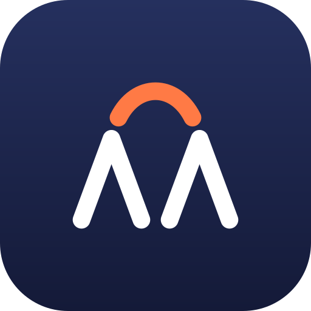

<p align="center">
  
</p>

<h1 align="center">ATA</h1>

<p align="center"><strong>Send files from your Android phone to your Mac computer.</strong><br>
Share from any app, pick your Mac, and the file lands in Downloads. The devices connect directly, everything is encrypted end to end, and there's no account and no cloud.</p>

<p align="center">
  <!-- At Android launch, replace the next line with: <a href="https://play.google.com/store/apps/details?id=io.github.magiclin99.ata">Android app (Google Play)</a> · -->
  Android app: coming soon to Google Play ·
  <a href="https://magiclin99.github.io/ata/install/">Install the Mac app</a> ·
  <a href="https://magiclin99.github.io/ata/">Website</a> ·
  <a href="https://magiclin99.github.io/ata/support/">Help</a> ·
  <a href="https://magiclin99.github.io/ata/zh-tw/">繁體中文</a>
</p>

---

This repository contains the **Android app**, the **Mac app**, and the **protocol specification** (`SPEC.md`,
`spec/vectors.json`, written in Traditional Chinese), all MIT licensed. Both apps are completely free (no in-app
purchases, no limits, no ads) and collect nothing. You can read the code to check that.

## Install (Mac)

```sh
curl -fsSL https://github.com/magiclin99/ata/releases/latest/download/install.sh | sh
```

The latest release is **ATA 1.0.2 for Mac** ([release notes](https://github.com/magiclin99/ata/releases/latest)).
The command installs whatever the latest release is, verifies its checksum and its signing certificate, and is also
how you update. Or download the `.dmg` from [Releases](https://github.com/magiclin99/ata/releases/latest). The app
isn't notarized, so the first launch needs one **Open Anyway** step. See the
[install guide](https://magiclin99.github.io/ata/install/). macOS 14 or later, Apple silicon and Intel.

## Get the Android app

**Android app: coming soon to Google Play** (Android 9 or later). Before release it goes through a
[closed test](https://magiclin99.github.io/ata/beta/), and you can join it: email [magiclin99@gmail.com](mailto:magiclin99@gmail.com?subject=ATA%20closed%20test) and include the Google
account address you use on your phone. The app is built from [`android-app/`](android-app/). To build it yourself,
see [Build from source](#build-from-source).

<!-- At Android launch, replace the paragraph above with:
Get ATA from [Google Play](https://play.google.com/store/apps/details?id=io.github.magiclin99.ata) (Android 9 or later). It's the same code as [`android-app/`](android-app/).
To build it yourself, see [Build from source](#build-from-source).
-->

## How it works

1. **Find**: the Mac advertises over Bluetooth LE. The phone finds it nearby and runs a mutual HMAC handshake using
   a 256-bit key created when you scanned the Mac's QR code.
2. **Connect**: over the encrypted Bluetooth channel, the devices agree on a path. The phone first tries a TCP
   connection over the local network (AES-256-GCM records). If that fails, it tries a WebRTC data channel using only
   public STUN (Google, Cloudflare), never TURN, so no relay is involved.
3. **Deliver**: files stream with a SHA-256 check per file and are written to `~/Downloads` (configurable) only
   after the checksum matches.

If neither path works (some strict networks block peer-to-peer), the phone says "no direct path" instead of falling
back to a server. Files never pass through any server.

## Security model

- Only paired devices can talk to each other. The pairing key comes from the Mac's QR code and never leaves the two
  devices. Every connection proves possession of it in both directions before anything else is sent.
- Everything after the handshake is encrypted: AES-256-GCM over Bluetooth and on the local network, DTLS on WebRTC
  (its fingerprints travel inside the encrypted Bluetooth channel). There is no server and no relay.
- Mac releases are signed with one fixed self-signed certificate. The installer refuses any other signature, and
  [`SECURITY.md`](SECURITY.md) shows how to check it yourself.

The full protocol, with test vectors both apps must pass, is in [`SPEC.md`](SPEC.md) (Traditional Chinese) and
[`spec/vectors.json`](spec/vectors.json). Found a problem? Please report it privately as described in
[`SECURITY.md`](SECURITY.md).

## Limits, plainly

- Android phone → Mac only. Not Mac → phone, not iPhone or iPad.
- The devices must be within Bluetooth range (about the same room). No remote sending.
- Fastest on the same Wi-Fi: about 60 MB in about 6 s in our tests, including setup. Across networks, roughly
  1 MB/s on mobile data, and it uses mobile data.
- No resume for interrupted transfers yet.

## Privacy

No accounts, analytics, ads, or servers. Neither app sends any data to the developer or to third parties. The only
outside contact is the peer-to-peer path: public STUN servers (Google, Cloudflare) see your IP address. Read the
[privacy policy](https://magiclin99.github.io/ata/privacy/).

<!--
SUPPORT SLOT (disabled). Uncomment once [[SUPPORT_URL]] is set.

## Support ATA (optional)

ATA is free and stays free. If it saves you time and you'd like to support its development, you can
[chip in here]([[SUPPORT_URL]]). It's entirely voluntary, and it doesn't unlock anything.
-->

## Repository layout

| Path | What |
|---|---|
| [`android-app/`](android-app/) | ATA for Android (Kotlin, Jetpack Compose). Details in [`android-app/README.md`](android-app/README.md). |
| [`mac-app/`](mac-app/) | ATA for Mac (Swift, SwiftUI). Details in [`mac-app/README.md`](mac-app/README.md). |
| [`SPEC.md`](SPEC.md) | Protocol specification v2 (Traditional Chinese). |
| [`spec/vectors.json`](spec/vectors.json) | Test vectors for the specification; both apps' tests read them in place. |
| [`site/`](site/) | The website at https://magiclin99.github.io/ata/. |
| [`.github/workflows/`](.github/workflows/) | Android CI and Mac CI (tests + builds), Mac release on tag `v*`, website deployment. |

## Build from source

Clone the whole repository: both apps' tests read `spec/vectors.json` from the root. No signing keys or other
secrets are needed for development builds.

**Mac** (Xcode 16 / Swift 6 toolchain, macOS 14 or later):

```sh
cd mac-app
swift test                      # unit and loopback tests
scripts/build-app.sh release    # → build/ATA.app, ad-hoc signed
```

**Android** (JDK 17 or newer, Android SDK with platform 36; point `sdk.dir` in `android-app/local.properties` or
`ANDROID_HOME` at it):

```sh
cd android-app
echo "sdk.dir=/path/to/Android/sdk" > local.properties   # or export ANDROID_HOME; the file is git-ignored
./gradlew :core:test assembleDebug   # → app/build/outputs/apk/debug/app-debug.apk
```

Release builds are signed with keys kept outside the repository; without them the Mac release script stops and the
Android release bundle is built unsigned. See each app's README, and [`CONTRIBUTING.md`](CONTRIBUTING.md) before
opening a pull request.

## Help and feedback

- Setup help and common fixes: [magiclin99.github.io/ata/support](https://magiclin99.github.io/ata/support/)
- Bugs and ideas: [GitHub Issues](https://github.com/magiclin99/ata/issues/new/choose)
- Security: [`SECURITY.md`](SECURITY.md)

## Licence

Both apps and the specification are released under the [MIT License](LICENSE). Third-party components and their
licences: [`mac-app/THIRD_PARTY_NOTICES.md`](mac-app/THIRD_PARTY_NOTICES.md) and
[`android-app/app/src/main/res/raw/third_party_notices.txt`](android-app/app/src/main/res/raw/third_party_notices.txt).

---

<sub>Android is a trademark of Google LLC. Mac is a trademark of Apple Inc., registered in the U.S. and other countries and regions. ATA is not affiliated with or endorsed by Apple or Google.</sub>
